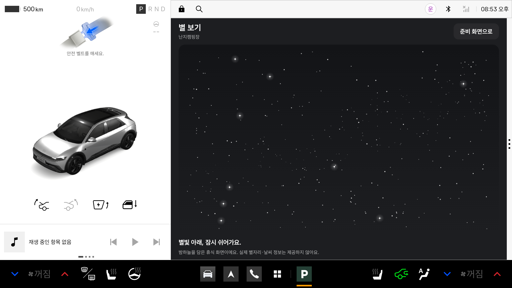

# IVI 0.5.4 — 별 보기 전용 화면

2026-11-14 · versionCode 7 · 저장 스키마 11 유지.

별 보기를 선택해도 테마만 어두워지던 구현을 수정했다. 차박 단계의 휴식/수면/별 보기 선택을 위로 올리고, 별 보기에서 앱 콘텐츠 전체를 전용 밤하늘 화면으로 전환한다. 390개의 별과 밝기 차이·광휘를 정적으로 그린다. 프레임 타이머·상시 애니메이션·센서·네트워크 요청은 추가하지 않았다.

준비 화면으로 버튼과 시스템 뒤로가기는 기존 차박 단계로 돌아오며 여행 조건·체크를 보존한다. Activity 재생성 후 별 보기 선택이 복원된다. 도착·주차·UX 허용 조건이 사라지면 별 화면을 숨기고 기존 조작 제한 화면을 사용한다. 실제 천체 위치·별자리·날씨를 제공하는 기능은 아니며 화면에서 이를 설명한다.

## 디자인

현대차 Pleos 시스템을 우선한다. 기존의 별도 갈색 밤 팔레트를 Pleos 다크 배경 `#1D1E21`, 표면 `#313236`, 흰색 본문으로 교정했다. 별 화면은 기존 Asta Sans, IviButton, 40/24/16dp 간격과 32dp 모서리를 사용한다. Figma `zHQP956O40m7ra3Bobyr4H`의 버튼 `16:293`을 재대조했다. 별 배경은 앱에서 직접 그리는 확장이며 Figma 원본 컴포넌트나 실제 관측 자료로 주장하지 않는다.

## 검증

| 범위 | 결과 |
| --- | --- |
| Release 빌드·Lint | 통과. [빌드](verification/release-0.5.4/build.txt), [시험 APK 재빌드](verification/release-0.5.4/test-build.txt) |
| JVM | IVI 14 + shared 55 = 69개, 실패/오류/스킵 0. [집계](verification/release-0.5.4/unit-tests.txt) |
| 실제 Activity 흐름 | 별 보기 클릭 → 별 렌더 → Activity 재생성 → 시스템 뒤로가기 → 재진입 → 준비 화면으로 복귀. tripId·입력·체크·단계·원래 테마 보존 |
| 화면 픽셀 | 별 영역 높이 250dp 이상, 2px 간격 샘플 중 밝기 0.6 초과 150개 이상, 12×8 구역 중 48개 이상에 별 분포, 어두운 배경 85% 초과. 단순 다크 테마만으로 통과할 수 없게 검사 |
| 좁은 창·큰 글자 | 800×1000dp/1.3배 글자, Light/Dark 시작값 모두 검사. [Light](verification/release-0.5.4/stars-narrow-light.png), [Dark](verification/release-0.5.4/stars-narrow-dark.png) |
| 제한 상태 | 화면 fixture의 restricted 전환 시 별 화면 숨김·조작 제한 표시, 해제 후 복원. 실제 D단 신호 변경 시험은 이번 범위에 포함하지 않음 |
| 밤 화면 회귀 | 자동 일몰/일출·수동 선택·홈/복귀·양 테마 본문 흰색 및 저장 복원 |
| 기기 시험 합계 | StarViewingTest 2 + NightDisplayScreenTest 3 + NightDisplayStoreTest 2 = 7개, 21.453초. [실행 로그](verification/release-0.5.4/star-tests.txt) |

넓은 창, 양 테마의 좁은 창, [준비 화면 복귀](verification/release-0.5.4/returned-to-preparation.png)를 직접 시각 확인했다. 좁은 창 캡처의 바깥 흰 영역은 800×1000dp 시험 컨테이너 밖이며 앱 레이아웃이 아니다. 시험은 기존 사용자 여행을 저장한 뒤 별도 fixture로 진행하고 종료 시 복원한다. 전체 새 여행·내비 SDK 시험을 이번 패치에서 반복 실행한 것으로 합산하지 않는다.

기존 AVD에 동일 서명 0.5.4를 업데이트하고 앱을 다시 실행했다. CPU 부하를 막기 위해 검증 종료 후 AVD를 일시정지했다. 데스크톱의 `Pleos 재개.command`로 다시 사용할 수 있다. 별 화면의 상시 애니메이션은 없지만 Pleos 시스템 자체의 CPU 부하가 해결됐다는 의미는 아니다.

## 산출물

- `~/Desktop/ChaPark-IVI-0.5.4-release.apk` 및 `.apk.sha256`
- `apk/차박차박_차Park_release.apk` — 동일한 로컬 제출 복사본
- 26,372,290 bytes
- SHA-256: `495bc5049a2e426c6d5343c8b827a557b2b5a07ca20b98c5f8c17b39a56015be`
- [서명 검증](verification/release-0.5.4/signature.txt): 기존 release 인증서, v2 서명 통과. 개발 서버 토큰 없는 release 설정 유지.
