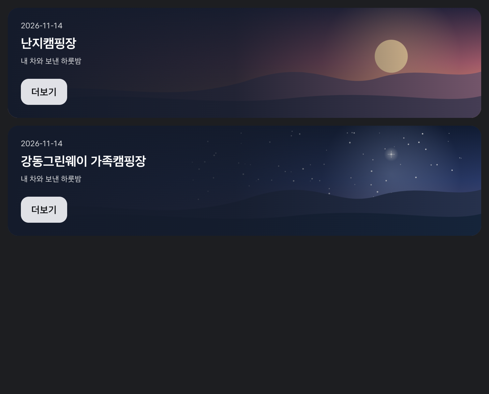

# IVI 0.5.5 — 별빛·노을 기록 카드

2026-11-15 · versionCode 8 · 저장 스키마 11 유지.

지난 기록과 여행 완료 화면을 같은 가로 그래픽 카드로 구성했다. 장소·날짜·짧은 문구를 먼저 표시하고 **더보기**를 누르면 저장 당시 배터리·준비 체크·경유·시간별 사건·누락 항목이 펼쳐진다. **접기**로 돌아갈 수 있으며 기록 삭제는 상세 안에서 기존 확인 대화상자를 거친다. 기록 창의 닫기 버튼은 스크롤해도 위에 남는다.

별빛 또는 노을 그림은 기록 ID에 따라 동일하게 유지되는 장식이다. 실제 관측·기상·위치를 나타내지 않으며 저장된 기록을 바꾸지 않는다. 정적 Canvas를 사용해 애니메이션·프레임 타이머·이미지 다운로드를 추가하지 않았다. 그래픽은 앱 확장이고 기존 Pleos Asta Sans·버튼·32dp 모서리·간격·라이트/다크 본문 색상을 재사용했다. 그림 위 텍스트는 어두운 그라데이션 위 흰색으로 유지한다.



## 검증

| 범위 | 결과 |
| --- | --- |
| Release 빌드·Lint | [최초 빌드](verification/release-0.5.5/build.txt), [저부하 설정 빌드](verification/release-0.5.5/low-load-build.txt), [최종 시험 APK 재컴파일·Lint](verification/release-0.5.5/test-build.txt) 통과 |
| JVM | IVI 14 + shared 55 = 69개, 실패/오류/스킵 0. [집계](verification/release-0.5.5/unit-tests.txt). 저부하 확인에서는 변경 없는 결과를 재사용 |
| 그래픽·큰 글자 | 두 그림 × Light/Dark × 넓은 창/800dp·1.3배 글자. 가로 비율, 더보기 노출, 그라데이션 색 분포와 해/별 픽셀 존재 검사. [시험 1](verification/release-0.5.5/card-test-1.txt) |
| 더보기·접기·삭제 취소 | 상세의 초기 숨김, 저장 당시 SOC/확인·누락·경유 값, 테마별 본문 색, 삭제 확인 후 취소, 접기/닫기. [시험 2](verification/release-0.5.5/card-test-2.txt) |
| 과거 기록 | 미수집 정보를 0 또는 성공으로 바꾸지 않음, 카드별 독립 펼침 상태. [시험 3](verification/release-0.5.5/card-test-3.txt) |
| 완료 화면 | 동일 카드 사용, 상세 초기 숨김, 여행 변경 이벤트 없음. [시험 4](verification/release-0.5.5/card-test-4.txt) |

기기 시험 4개는 실제 Release APK와 동일 서명의 시험 APK에서 **각 메서드를 별도 instrumentation 실행으로 검증**했다. [최종 세션](verification/release-0.5.5/device-session.txt). 한 프로세스로 연속 실행할 때 Pleos 창 전환 중 Compose 루트 소실 및 ActivityScenario 종료 오류가 발생한 [실패 기록](verification/release-0.5.5/combined-run-failure.txt)을 보존한다. 전체 클래스를 한 번에 실행해 통과했다고 해석하지 않는다. 화면 준비 시 창 초점/크기 안정화를 기다리고, 최종 이미지는 앱의 Compose 렌더링 결과를 직접 캡처했다.

최종 [기록 창](verification/release-0.5.5/history-dark.png), [큰 글자 카드](verification/release-0.5.5/cards-narrow-dark.png), [라이트 상세](verification/release-0.5.5/details-light.png), [다크 상세](verification/release-0.5.5/details-dark.png)를 직접 확인했다. 캡처의 여행 데이터는 시험 fixture이며 사용자 기록을 새로 생성하지 않는다. 기존 활성 여행은 시험 전 보관하고 종료 시 복원했다. 이번 범위는 기록 UI이며 내비·실차·전체 여행 인수를 새로 수행한 결과가 아니다.

재실행은 아래처럼 메서드별로 실행한다. 네 메서드 이름은 `TripMemoryScreenTest`를 따른다.

```sh
python3 scripts/pleos-session.py --timeout 60 -- \
  .local-avd/tools-venv/bin/python scripts/pleos-device.py --port 5559 shell \
  'am instrument --user 10 -w -e class com.chapark.ivi.TripMemoryScreenTest#moreShowsOnlyArchivedFactsAndCollapseHidesDetailsInBothThemes com.chapark.ivi.test/androidx.test.runner.AndroidJUnitRunner'
```

## 발열 대응과 산출물

Gradle worker 1개·비병렬·JVM ActiveProcessorCount=1·Kotlin in-process·상주 데몬 해제를 적용했다. 빌드 중 에뮬레이터를 멈추며 기기 시험은 제한 시간과 종료 후 자동 일시정지를 사용한다. [정상/실패/시간 초과 후 정지 확인](verification/release-0.5.5/session-guard.txt). 검증 종료 후 QEMU 0.0%, Java 빌드 프로세스가 없는 것을 확인했다. 이는 Pleos 실행 중 3D 시스템 부하 자체를 없애거나 발열 온도를 보장하는 조치는 아니다.

- `~/Desktop/ChaPark-IVI-0.5.5-release.apk` 및 `.apk.sha256`
- 동일 로컬 제출 복사본: `apk/차박차박_차Park_release.apk`
- 26,372,290 bytes
- SHA-256: `0a2a07cb4bd3b1e57370bc62fcb7805ad9524915db6ef13d67c3a8c54ef9cf7e`
- [기존 인증서·v2 서명 확인](verification/release-0.5.5/signature.txt)

기존 AVD에 0.5.5를 업데이트하고 원래 여행으로 앱을 다시 실행한 뒤 일시정지했다. 데스크톱 `Pleos 시작.command`로 재개할 수 있다.
